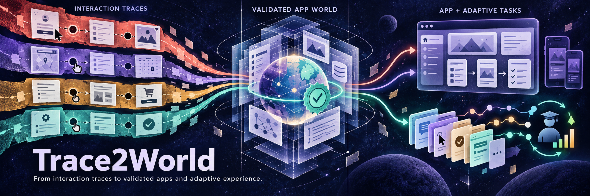
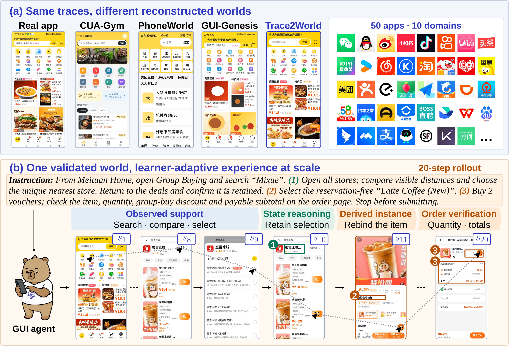
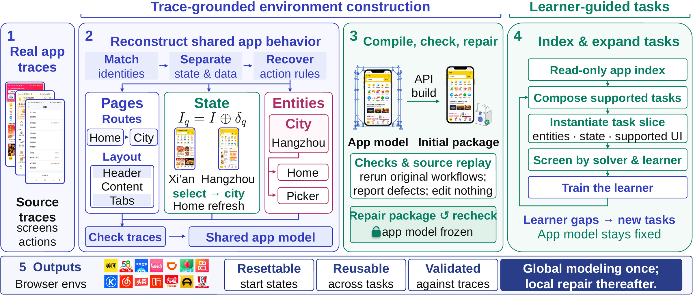
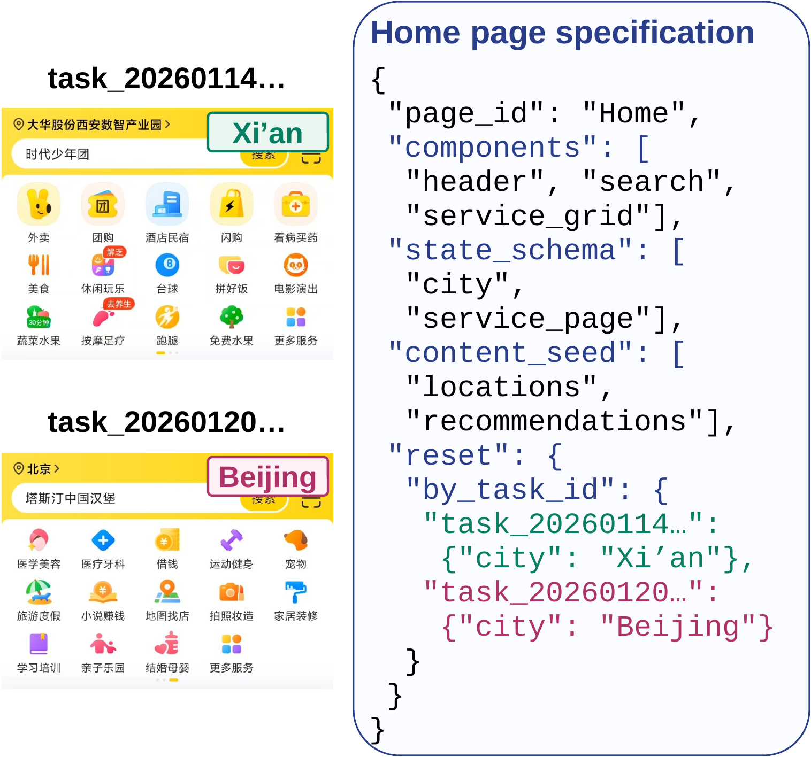
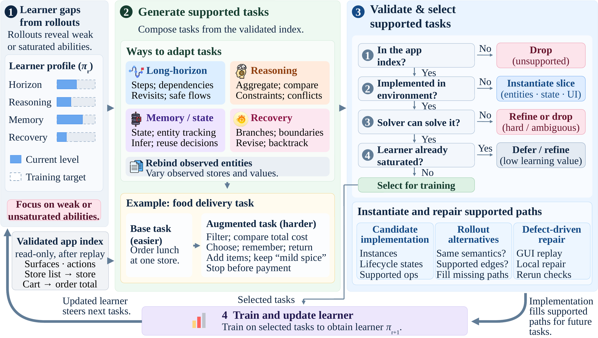

<div align="center">



<br>

[](#citation)
[](https://huggingface.co/datasets/LEONW24/Trace2World)
[](LICENSE)
[](trace2world_env/pyproject.toml)

</div>

Scaling GUI reinforcement learning requires environments that preserve real-app behavior. Yet
coupling behavior inference with coding can turn partial traces into runnable mocks with incorrect
state transitions.

**Trace2World** separates global behavior reconstruction from implementation. It reconciles traces
into a shared, source-linked app model, then compiles an executable environment. Independent replay
of source workflows localizes mismatches for bounded implementation repair. Validated worlds then
support learner-adaptive task and environment augmentation within source-supported behavior.

- **Global behavior reconstruction as the semantic contract.** Source-linked semantics are fixed
  from evidence before any code exists. From **1,570 partial traces**, Trace2World builds **50 shared
  worlds** across **10 domains**; on 200 workflows across ten apps, **91.1%** pass all six source
  checks versus 59.8% for the strongest existing route, a matched task-local GUI-GENESIS-style build.
- **Source-grounded detection with bounded local repair.** Independent replay of every original
  workflow checks six source obligations, apart from builder tests and RL rewards, and shows that
  every existing route reaches endpoints it cannot preserve. Replacing replay with self-validation
  lowers the share passing all six from 91.1% to 79.1% and real-device gain retention from
  **94.0% to 54.7%**.
- **Validated worlds that index and expand cheaply.** Forty validated environments supply 1,280 seed
  and 768 learner-guided tasks within fixed source support. Learner guidance raises benchmark success
  from 56.9% to **61.1%**; training in Trace2World improves the model by **20.2 points** on
  Trace2World-Bench, **5.4–16.2 points** across four external GUI benchmarks, and **16.3 points** on
  100 real-device tasks.

<div align="center">


<sub><b>Faithful app worlds, learner-adaptive experience at scale.</b> (a) Left: baseline environments constructed from the same source traces. Right: 50 reconstructed apps across ten domains. (b) Learner-adaptive tasks recombine source-supported behavior with state reasoning, derived instances, and order verification.</sub>
</div>

This repository is the **code** half of the release: the environment host / evaluators / bundled agent
([`trace2world_env/`](trace2world_env)) and the environment constructor
([`trace2world_pipeline/`](trace2world_pipeline)). The **data** half, the environments and the source
traces they were built from, is the Hugging Face project dataset
[`LEONW24/Trace2World`](https://huggingface.co/datasets/LEONW24/Trace2World) (`environments/` and
`traces/`); the download scripts below pull and verify it.

## Method

<div align="center">

</div>

**Semantic commitment before implementation, source acceptance afterward.** Partial traces are
reconciled into one source-linked model of shared app behavior; unresolved behavior stays
non-executable. Bounded API calls compile the model into a package; code checks and replay of the
original workflows only report defects, and repair edits the package while the model stays frozen.
The validated world is indexed read-only and expanded with learner-guided tasks.

<table>
<tr>
<td width="38%" valign="top">

<sub><b>Two traces, one Home page.</b> Xi'an and Beijing are supported initial values of the same city state field. The task selects a reset value; subsequent behavior uses the shared page and state-dependent action rules.</sub>
</td>
<td width="62%" valign="top">

<sub><b>Learner-guided tasks from a validated app index.</b> Task generation combines supported surfaces, operations, and dependencies from the validated package's read-only index into a task adapted to the current learner. Learner gaps guide sampling; source, GUI, solver, and learner-signal checks screen candidates. Missing entity, state, or UI slices are instantiated in the package; the app model is unchanged.</sub>
</td>
</tr>
</table>

## Results

**End-to-end reconstruction fidelity (%).** Ten-app macro means over the same 200 source workflows.
*All six* (workflow fidelity) requires every check; *Reach* checks only the endpoint. Every existing
route reaches endpoints it cannot preserve.

| Method | All six | Reach | Surface | State | Effect | Terminal | Data |
|---|---:|---:|---:|---:|---:|---:|---:|
| Direct w/o traces | 5.2 | 28.4 | 14.8 | 22.7 | 15.0 | 15.9 | 12.8 |
| Direct + traces | 16.7 | 53.6 | 35.3 | 41.2 | 34.6 | 33.7 | 31.7 |
| CUA-Gym w/o traces | 8.2 | 34.4 | 20.0 | 29.0 | 22.6 | 21.5 | 19.6 |
| CUA-Gym + traces | 19.9 | 50.4 | 37.5 | 38.0 | 35.0 | 35.3 | 35.0 |
| PhoneWorld-style | 22.4 | 57.0 | 39.3 | 46.8 | 41.5 | 39.8 | 38.5 |
| GUI-GENESIS-style | 59.8 | 94.8 | 83.9 | 76.6 | 77.0 | 79.4 | 78.4 |
| **Trace2World** | **91.1** | **98.0** | **93.7** | **93.3** | **93.8** | **93.7** | **94.1** |
| *Control: self-validation (not our method)* | *79.1* | *98.5* | *90.4* | *87.0* | *85.0* | *88.0* | *89.1* |

**Downstream policy performance (%).** Trace2World-Bench and MobileGym (MG) report SR / PR;
AndroidWorld (AW), MobileWorld (MW), and AndroidDaily (AD) report SR (MW: GUI-only SR@50). The fixed
Qwen3.5-9B block isolates training gain; no task from the four external suites enters Trace2World
task generation, screening, RL, or checkpoint selection.

| Policy (Qwen3.5-9B) | Trace2World-Bench | MG | AW | MW | AD |
|---|---:|---:|---:|---:|---:|
| Base | 40.9 / 55.4 | 9.0 / 19.7 | 57.8 | 18.5 | 47.2 |
| Stage-1 (seed tasks) | 48.7 / 64.6 | 15.8 / 28.4 | 60.1 | 21.9 | 51.9 |
| **Ours** (learner-guided) | **61.1 / 71.1** | **25.2 / 40.7** | **63.2** | **27.4** | **58.3** |

**Real-device transfer on 100 paired tasks** from 20 apps (gains over base, pp; three-seed mean).
Real/sim is gain retention; Sim-only pass is simulation-only success.

| Metric | Self-validation | Source-trace validation | Ours |
|---|---:|---:|---:|
| Real gain | 9.7 | 15.7 | **16.3** |
| Sim. gain | 17.7 | 16.7 | 18.7 |
| Real/sim gain | 54.7% | **94.0%** | 87.5% |
| Sim-only pass | 18.3% | 10.0% | 10.7% |

## What is released

Trace2World is released as an environment-construction resource, not as a benchmark alone. The
release binds the source evidence, the reconstructed environments, the training-task supply, the
evaluation sets, and the fidelity records of the paper.

| Component | Scale | Role | Where |
|---|---|---|---|
| Source traces | 1,570 traces / 50 apps | construction evidence; external fidelity authority | [`LEONW24/Trace2World`](https://huggingface.co/datasets/LEONW24/Trace2World) `traces/`: source recordings, action records, instructions, terminal contracts, collection metadata |
| Construction pipeline | one shared pipeline | trace → reconciled specification → environment | this repo, [`trace2world_pipeline/`](trace2world_pipeline): preprocessing, reconciliation, compilation, validation and repair |
| Environment portfolio | 50 apps / 10 domains | resettable GUI RL substrate | [`LEONW24/Trace2World`](https://huggingface.co/datasets/LEONW24/Trace2World) `environments/`: standalone packages with state and evaluator manifests |
| Environment host | one process, all apps | serve, step, evaluate | this repo, [`trace2world_env/`](trace2world_env): `t2w-serve`, `t2w-rollout`, `t2w-smoke` |
| Training-task supply | 1,280 seed + 768 learner-guided | policy optimization | task, launch, support and evaluator manifests |
| Trace2World-Bench | 1,044 tasks | frozen policy evaluation | task definitions, split identities, evaluators |
| Fidelity study | 200 workflows / 10 apps | reconstruction correctness | source/execution packets, reviewer labels, human adjudication |
| Real-device panel | 100 tasks / 20 apps | paired sim-to-real evidence | frozen task manifests, paired outcomes |

Every task, checkpoint and evaluator is frozen exactly as used for the reported numbers; the host does not
rewrite or relax them.

## Environments

All 50 applications provide construction traces and all 50 are reconstructed. Policy optimization uses
tasks from the 40 policy-training applications only; the ten held-out applications, one per domain, supply
construction traces but no seed, candidate, screening or RL-update task.

| Domain | Policy-training apps (40) | Held-out eval app (10) |
|---|---|---|
| Social & community | WeChat, QQ, Weibo, Xiaohongshu | Zhihu |
| News & short video | Kuaishou, Bilibili, Toutiao, Tencent News | Douyin |
| Long video & audio | iQIYI, Youku, NetEase Cloud Music, Kugou Music, Ximalaya | QQ Music |
| Commerce & resale | Taobao, JD, Xianyu, Dewu | Pinduoduo |
| Local services & food | Meituan, Dianping, Dingdong Maicai, KFC, Hema | Ele.me |
| Mobility, travel & tickets | Amap, Ctrip, Didi, Railway 12306, Damai | Taopiaopiao |
| Auto, housing & jobs | 58Tongcheng, Autohome, Dongchedi, BOSS Zhipin | Beike |
| Work, learning & search | Feishu, WPS Office, Baidu, DingTalk, Youdao Dictionary, Baidu Netdisk | Tencent Meeting |
| Payment & logistics | Alipay, SF Express | Cainiao |
| Health & fitness | Boohee Health | Keep |

Trace collection is an evidence quota fixed before construction: an application with at least three
independent service lines receives 50 traces, every other application 20 (19 multi-service apps × 50 +
31 single-service apps × 20 = 1,570). Each environment is a reconstructed browser simulation with
synthetic content; it connects to no real service and carries no production credential.

**Trace2World-Bench** is one frozen evaluation view over the portfolio (1,044 tasks, SR averaged over
three attempts per task):

| Slice | Application coverage | Tasks |
|---|---|---:|
| Entity replacement | training-side workflow skeletons, new entities | 256 |
| Held-out workflow | 20% workflow-signature split (320 seed + 192 aug.) | 512 |
| Cross-app | 10 policy-training-app pairs, return-dependent A→B→A | 100 |
| Unseen apps | 10 apps excluded from policy training | 176 |

## Quick start

### 1. Install

```bash
git clone https://github.com/LEON-gittech/Trace2World.git
cd Trace2World

python3.12 -m venv .venv && source .venv/bin/activate
pip install ./trace2world_env huggingface_hub
export PLAYWRIGHT_BROWSERS_PATH="$HOME/.t2w-browsers"   # keep Chromium out of ~/.cache
playwright install chromium
```

### 2. Download the environments

```bash
python scripts/download_environments.py        # -> data/trace2world, verified against the manifest
```

### 3. Start the environment server

```bash
t2w-serve --environments-dir data/trace2world \
          --state-root /tmp/t2w-state --host 127.0.0.1 --port 6800
curl -s http://127.0.0.1:6800/health | python -m json.tool     # ok=true, environment and task counts
```

One process hosts the whole portfolio; the pages, tasks, evaluator and state kernel are selected from
`task_id`. Every task starts from a task-conditioned initial state and is fully reset between episodes.

### 4. Run a rollout

With the bundled text-feedback agent against any OpenAI-compatible `/chat/completions` endpoint:

```bash
export MODEL_API_KEY='...'
t2w-rollout --server http://127.0.0.1:6800 \
            --task-id <task_id> \
            --llm-base-url http://<model-host>:<port>/v1 --model <served-model-name> \
            --output trajectory.json
```

Or drive the HTTP API from your own agent in any language. A step is one public action call in the
pixel-space action space of the paper (`click` / `double_click` / `long_press`, `type`, `swipe` / `scroll`,
`drag`, `open_app`, `system_button`, `wait`, `answer`, `terminate`); the same interface serves training
and evaluation rollouts, and a rejected action returns typed text feedback with no state change:

```python
import httpx

BASE, TASK = "http://127.0.0.1:6800", "<task_id>"
with httpx.Client(base_url=BASE, timeout=300) as c:
    did = c.post("/display/acquire").json()["logical_id"]
    c.post("/task/init", json={"task_name": TASK, "display_id": did}).raise_for_status()
    goal = c.get("/task/goal", params={"task_name": TASK, "display_id": did}).json()
    for _ in range(50):
        obs = c.get("/screenshot", params={"display_id": did, "return_b64": "true"}).json()
        action = my_policy(goal, obs["b64_png"])              # pixel-space action dict, see trace2world_env/README.md
        step = c.post("/step", json={"display_id": did, "action": action}).json()
        if action["action_type"] in {"answer", "terminate"}:
            break
    ev = c.get("/task/eval", params={"task_name": TASK, "display_id": did, "preview": "false"}).json()
    print("reward =", ev.get("raw_reward", ev.get("score")))
    c.post("/task/tear_down", json={"task_name": TASK, "display_id": did})
    c.post("/display/release", params={"display_id": did})
```

Rewards come from the frozen task evaluator (terminal success and partial final-state credit); the
source-trace replay that accepts each environment is a separate reviewer and never supplies training
reward.

### 5. Self-check

```bash
t2w-smoke --server http://127.0.0.1:6800 \
          --manifest data/trace2world/environments_manifest.json --output host-smoke.json
```

Runs one real browser round-trip per environment (init, screenshot, action, text feedback, evaluator
reward, tear-down). The full contracts (HTTP API, action space, reward semantics, initial states,
concurrency) are documented in [`trace2world_env/README.md`](trace2world_env/README.md).

## Building your own environment

`trace2world_pipeline` is the constructor that produced the released environments. It takes the source
traces of one app and runs the paper's construction path end to end: global behavior reconstruction
(Algorithm 1: *Restore / Reconcile / Factorize / Supported* — trace-local evidence → canonical page,
entity and state identity → Structure/State/Data factorization → source-supported behavior only),
page realization and task composition, then source acceptance (Algorithm 2: bounded *Execute / Review /
Probe* with *Repair / Invalidate*, `K = 3`) that replays the original workflows against the built
environment and repairs the package while the app model stays frozen.

```bash
pip install ./trace2world_pipeline && playwright install chromium
export OPENAI_API_KEY='...'          # any OpenAI-compatible endpoint; see trace2world_pipeline/README.md
python scripts/download_reference_traces.py --environments kfc   # -> data/trace2world/traces/kfc
t2w-construct --config <config.json> --trace-dirs data/trace2world/traces/kfc --output-dir <result_dir>
t2w-verify    --config <verify_config.json>
t2w-close     --result-dir <result_dir> --ledger <ledger.json> --operators <module>:<factory>
t2w-export-environment --result-dir <result_dir> --package-dir <environment_dir>
```

The stage-by-stage mapping to the paper's algorithms, the external services it calls, and the real
parameters used for the release are in [`trace2world_pipeline/README.md`](trace2world_pipeline/README.md)
and [`trace2world_pipeline/WORKFLOW.md`](trace2world_pipeline/WORKFLOW.md). Because the source traces of
every environment are released, each environment can be rebuilt from its inputs.

## Repository layout

```text
Trace2World/
├── README.md
├── LICENSE                          MIT (code); see the dataset card for the data terms
├── CITATION.cff
├── assets/                          figures used in this README
├── scripts/
│   ├── download_environments.py     pull + verify the environments from the Hub
│   ├── download_reference_traces.py pull + verify the source traces (all or selected apps)
│   └── verify_environments.py       SHA-256 / task-count check of a release directory
├── trace2world_env/                 environment host, evaluators, state kernel, bundled agent
│   ├── README.md                    HTTP API, action space, reward semantics, manifest fields
│   ├── pyproject.toml               t2w-serve / t2w-rollout / t2w-smoke
│   └── src/trace2world/
└── trace2world_pipeline/            environment constructor
    ├── README.md                    stage layout and paper-algorithm mapping
    ├── WORKFLOW.md                  end-to-end construction order with real parameters
    ├── pyproject.toml               t2w-construct, t2w-verify, t2w-close, t2w-export-environment, ...
    └── src/trace2world_pipeline/
```

`data/trace2world/` is the local checkout of
[`LEONW24/Trace2World`](https://huggingface.co/datasets/LEONW24/Trace2World) created by the download
scripts; `data/` is git-ignored.

## Ethics and scope

Source traces were collected by consenting operators from accounts they control, with consent covering
research use and public release. Every recording was reviewed for credentials and session material,
personal identifiers, private communications, precise locations, payment or order information, and
third-party personal data before release; a trace whose safe release would alter its interaction evidence
is withheld and listed rather than trimmed. The released environments are isolated browser
reimplementations with synthetic content that use application names only to identify the systems
studied, without implying affiliation or endorsement.

## Citation

The preprint is being prepared; the entry below will be updated with the arXiv identifier.

```bibtex
@article{wang2026trace2world,
  title   = {Trace2World: Reconstructing App Worlds from Real Interaction Traces for Scalable GUI Agent Training},
  author  = {Wang, Zezhou and Zhou, Hanzhang and Tong, Panrong and Kong, Quyu and
             Li, Pengxiang and Hoi, Steven and Qian, Zhuzhong and Wang, Yue},
  journal = {arXiv preprint},
  year    = {2026}
}
```

## License

The code in this repository is released under the [MIT License](LICENSE). The environments and source
traces are distributed under the terms stated on the Hugging Face dataset card.
